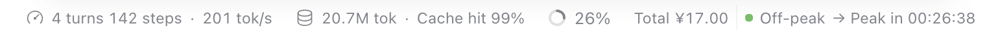

# dsh-plugin-deepseek-balance

A DSH profile plugin that adds one ambient status line to the composer dock, to the
right of the context meter:

```
Total ¥17.62 │ ● Off-peak → Peak in 00:45:53
```



*The status line sits at the right end of the composer dock, next to the context meter.*

It shows the account's total balance (the sum of granted and topped up) and whether
the current hour is peak or off-peak pricing, with a live countdown to the next price
switch. The line uses the same type scale, color, padding and radius as the shipped
composer stat pills, so it reads as one more reading in that status bar; the granted /
topped-up split is still in the hover tooltip rather than the line itself.

Hovering the line gives the full picture (next switch in local time, why the current
hour is off-peak, the peak windows, holiday-data status, the balance fetch time);
clicking it refreshes immediately.

## Install

This is a DSH profile plugin bundle (Host half + Web Client half).

1. Store the API key in the profile's credential service under `DEEPSEEK_API_KEY`
   (`ctx.credentials.resolve` reads it; the process environment is the fallback).
2. Install the bundle by pointing DSH's plugin manager at this directory — in an
   agent session, `plugin_manager` with `action: install_bundle` and `target` set to
   the absolute path of this checkout. Its `cordis.patch.yml` inserts the
   `dsh-plugin-deepseek-balance` row into the profile.
3. Open a conversation: the line appears at the right end of the composer status bar.

Requires a DSH build with the Web GUI (`dsh.client.platform: web`) and the
`conversation.composer.dock` slot.

To install the published copy instead of a checkout, point `install_bundle` at the
repository: `https://github.com/wzy816/dsh-plugin-deepseek-balance`.

The package ships no icon, so the Plugins panel uses its default artwork for this
bundle.

## Price rule

Peak hours are **01:00–04:00 and 06:00–10:00 UTC, Monday through Friday, excluding
Chinese public holidays** (per the DeepSeek pricing page). Every other hour is
off-peak, including weekends and Chinese public holidays in full.

The plugin evaluates the rule on the Host using UTC instants and Chinese holiday
dates from [timor.tech](https://timor.tech/api/holiday). Holiday data is cached per
year. Because a switch can only happen at a window edge or at UTC midnight, the next
switch instant is exact.

## Where the numbers come from

| Value | Source |
|---|---|
| `granted_balance`, `topped_up_balance` | `GET https://api.deepseek.com/user/balance` with the profile's API key |
| Total shown | `granted_balance + topped_up_balance`, summed in the Client half |
| Chinese public holidays | `GET https://timor.tech/api/holiday/year/{year}` |

The API key never reaches the browser: the Host half resolves the credential
reference (`DEEPSEEK_API_KEY` by default) through the profile credential store, with
the process environment as an ambient fallback, and serves one same-origin JSON
snapshot on `/_dsh/deepseek-balance`. The browser only polls that route.

## Configuration

Edit the row's `config` through the profile's `cordis.patch.yml` (the plugin's own
patch also carries it, and a user patch override wins):

```yaml
- id: dsh-plugin-deepseek-balance
  name: dsh-plugin-deepseek-balance
  config:
    apiKeyRef: DEEPSEEK_API_KEY          # credential reference (env-var name)
    apiBase: https://api.deepseek.com    # balance endpoint base
    holidayApiBase: https://timor.tech/api/holiday
    balanceTtlSeconds: 60                # balance cache; also the manual-refresh cadence
    holidayTtlSeconds: 21600             # 6h holiday cache
    requestTimeoutMs: 15000
```

## Behaviour and limits

- The status line renders only while a conversation is open (the
  `conversation.composer.dock` slot is session-scoped).
- The dock is a plain block in the host, so the Client half turns it into one
  wrapping, right-aligned flex strip and gives this entry `order: 1`, which places
  it after the context meter at the right edge of the status bar.
- If holiday data for a required year is not published yet, the hour is judged by
  UTC weekday only, and the tooltip says so.
- A missing or rejected API key renders `Balance no API key` / `Balance unavailable`
  and keeps the price-period half working; the failure reason is in the tooltip.
- The snapshot route allows only loopback / this machine's own Host headers.

## Files

| File | Role |
|---|---|
| `index.js` | Host half: credential resolution, balance and holiday fetches, price-period evaluation, `/_dsh/deepseek-balance` route |
| `client.js` | Client half: registers into `conversation.composer.dock`, renders the line, ticks the countdown, polls the snapshot |
| `cordis.patch.yml` | Bundle patch inserting the plugin row |
| `locale/en.json`, `locale/zh.json` | Plugin manager title and description |
| `assets/screenshot.png` | Status-bar screenshot used by this README |
